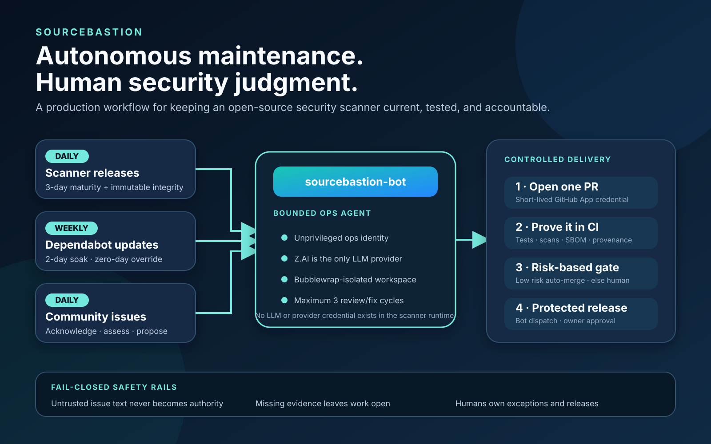

# SourceBastion Scan

[](https://github.com/sourcebastion/sourcebastion-scanner/releases/latest)
[](https://github.com/sourcebastion/sourcebastion-scanner/releases/latest)

**Deterministic application security scanning** — free, open-source, works with GitHub and GitLab.

The CLI, Python package, and existing container images retain the `ez-appsec`
name for compatibility. This repository is their maintained upstream home;
it is not deprecated.

SourceBastion Scan orchestrates four best-in-class scanners (gitleaks, semgrep, kics, grype), normalises their output into a unified schema, and pushes results to a hosted security dashboard. No cloud account or API key required.

> [!NOTE]
> **Autonomously maintained, human-governed.** `sourcebastion-bot` checks this
> project daily for mature upstream scanner releases and new issues, and batches
> dependency updates weekly. Dependabot PRs must remain open for at least two
> full days before integration; a human-applied `security/zero-day` label may
> waive only that age gate for a confirmed emergency. Every change still passes
> the hosted CI and security suite. Issue-derived changes and releases require
> human review or approval. Found a problem or have an idea? Please open a
> [bug report](https://github.com/sourcebastion/sourcebastion-scanner/issues/new?template=bug_report.md)
> or [feature request](https://github.com/sourcebastion/sourcebastion-scanner/issues/new?template=feature_request.md).
> Report vulnerabilities privately through the
> [Security tab](https://github.com/sourcebastion/sourcebastion-scanner/security/advisories/new),
> not as public issues. The scanner itself makes no LLM calls and needs no LLM
> credential.



```
Your codebase
     │
     ▼  SourceBastion Scan (`ez-appsec scan`)
┌────────────────────────────────────────────┐
│  gitleaks · semgrep · kics · grype         │
│  secrets    SAST      IaC    dependencies  │
└──────────────────┬─────────────────────────┘
                   │  unified vulnerability schema
                   ▼
     CLI · JSON · SARIF · GitLab format
                   │
                   ▼
     Security Dashboard (GitHub / GitLab Pages)
```

---

## Quickstart with GitHub Actions

The reusable [sourcebastion-action](https://github.com/sourcebastion/sourcebastion-action)
owns CI execution and result delivery; the scanner supplies the scanning engine.

```yaml
name: SourceBastion
on: [push, pull_request]
permissions:
  contents: read
jobs:
  scan:
    runs-on: ubuntu-latest
    steps:
      - uses: actions/checkout@3d3c42e5aac5ba805825da76410c181273ba90b1 # v7
      - uses: sourcebastion/sourcebastion-action@192c82af06a9b003aaed816d948e3e2768d7b7fc
```

For organization installation, use the platform's `sourcebastion-org-sync`
operator command; see the [migration guide](docs/enterprise.md). Legacy private
skills that dispatch the scanner's removed `app-install.yml` must be updated
before use. Repository writer credentials belong to platform provisioning,
not the scanner image.

---

## Platform Guides

| Platform | Guide |
|----------|-------|
| GitHub | [docs/github.md](docs/github.md) |
| GitLab | [docs/gitlab.md](docs/gitlab.md) |
| Dashboard | [docs/dashboard.md](docs/dashboard.md) |
| SourceBastion scan contract | [docs/sourcebastion-scan-contract.md](docs/sourcebastion-scan-contract.md) |

---

## Legacy SourceBastion Scan Skills Reference

The `/ez-appsec` Claude Code skill is a dispatcher — the first word routes to the right subcommand.

### Installation

| Command | Description |
|---------|-------------|
| `/ez-appsec install-app [owner/repo]` | **GitHub** — installs the scan workflow, provisions App secrets, and triggers the first scan |
| `/ez-appsec install [path]` | **GitLab** — patches `.gitlab-ci.yml` with the `scan.yml` include and opens a merge request |
| `/ez-appsec install-dashboard [owner/repo]` | **GitHub** — creates and configures the dashboard repo with GitHub Pages and App secrets |

### Scanning

| Command | Description |
|---------|-------------|
| `/ez-appsec scan [path]` | Scan with Docker and load findings into context for analysis |
| `/ez-appsec load [project]` | Load a project's vulnerabilities from the dashboard into context for analysis |
| `/ez-appsec remediate [filter]` | Prioritized fix plan balancing severity vs risk — applies safe fixes immediately, confirms risky ones once |

### Maintenance

| Command | Description |
|---------|-------------|
| `/ez-appsec update-dashboard [owner/repo]` | Re-provision App secrets and update dashboard web assets to the latest release |
| `/ez-appsec uninstall-app [owner/repo]` | **GitHub** — removes the scan workflow and prunes the repo's dashboard data |
| `/ez-appsec uninstall [path]` | **GitLab** — removes the `scan.yml` include via merge request |

### Help

| Command | Description |
|---------|-------------|
| `/ez-appsec help` | Print available subcommands |

---

## Scanners

| Scanner | What it finds |
|---------|--------------|
| [gitleaks](https://github.com/gitleaks/gitleaks) | Secrets and credentials (140+ patterns) |
| [semgrep](https://semgrep.dev/) | SAST — logic bugs, injection, misuse (1000+ rules) |
| [kics](https://www.kics.io/) | Infrastructure-as-code misconfigurations |
| [grype](https://github.com/anchore/grype) | Known CVEs in dependencies and SBOMs |

All findings are normalised into a unified schema with consistent severity levels, file paths, and line numbers.

---

## Known Limitations

SourceBastion Scan is in active development. Current coverage and accuracy reflect testing against OWASP Juice Shop, DVWA, and production codebases. See [TEST_RESULTS.md](TEST_RESULTS.md) for full details.

### Detection Accuracy

| Category | Detection Rate | Notes |
|----------|----------------|-------|
| Infrastructure/Config (KICS) | ~100% | 254 findings, 12.5% false positive rate |
| Secrets Scanning | 0% | Gitleaks integration pending |
| SQL Injection | 0% | Pattern-based rules planned |
| XSS | 0% | Framework-specific rules needed |
| Authentication Failures | 0% | Runtime analysis required |
| CSRF | 0% | CSRF token patterns only |

### Coverage Gaps (High Priority)

1. **Secrets Scanning** (Critical) - Hardcoded API keys, credentials, tokens
2. **SQL Injection** - MySQL, PostgreSQL, SQLite patterns
3. **XSS** - Reflected, stored, DOM-based XSS
4. **NoSQL Injection** - MongoDB, Redis, Elasticsearch
5. **Framework-Specific** - Laravel, Django, Spring, Express security patterns

### False Positive Sources

1. **Code Quality Issues** (~75%) - Unused imports, style violations
2. **Context-Insensitive Matches** (~20%) - String literals flagged as SQL
3. **Test Code** (~5%) - Test fixtures flagged

False positives can be suppressed using `.gitleaks.toml` (gitleaks) and `.semgrepignore` (semgrep) files.

### Performance Characteristics

| Codebase Size | Files | Scan Time | Memory |
|---------------|-------|-----------|---------|
| Small | 50 | <10s | <500MB |
| Medium | 200 | <30s | <1GB |
| Large | 1,000 | <120s | <2GB |

Linear scaling validated. CI/CD compatible: GitHub Actions (2-core, 7GB), GitLab CI (4-core, 4GB).

---

## Docker Images

```bash
# Complete scanner; Docker selects AMD64 or ARM64 automatically
docker pull ghcr.io/sourcebastion/sourcebastion-scanner:latest

# Run a scan
docker run --rm -v "$(pwd):/scan" \
  ghcr.io/sourcebastion/sourcebastion-scanner:latest scan /scan
```

Full-version and full-commit tags are immutable. Every release image includes
an SBOM and signed GitHub build provenance. Verify a pinned image with:

```bash
gh attestation verify \
  oci://ghcr.io/sourcebastion/sourcebastion-scanner@sha256:<digest> \
  --repo sourcebastion/sourcebastion-scanner
```

The legacy `ghcr.io/ez-appsec/ez-appsec` images remain available for existing
immutable pins while consumers migrate; new integrations should use the
SourceBastion namespace.

### Parallel scanner components

`SOURCEBASTION_MAX_CONCURRENT_SCANNERS` limits the number of enabled scanner
tools running **at the same time on one source tree**. Values from **1 to 10**
are accepted; the default is **10**, so component concurrency is enabled without
an environment-specific code path. Only available enabled scanners are started;
a limit of 10 does not create ten copies of each scanner.

For Docker, override it with `-e SOURCEBASTION_MAX_CONCURRENT_SCANNERS=2` when a
worker needs a smaller CPU/memory working set. Set the same environment variable
on the scanner container in Kubernetes. `1` selects serial execution. This
applies to `scan` and `contract-scan`, including partial component execution;
it does not change the number of repository scan jobs running at once.

`SOURCEBASTION_SCANNER_WORKERS` remains a deprecated fallback for one migration
cycle so an existing explicit resource limit is preserved. The new name wins
when both are set. Migrate maintained deployment and CI configuration now;
remove the fallback at the next scanner minor release after maintained consumers
use the descriptive name.

Findings keep their configured or plan order. Component timeouts and the scan
plan deadline still apply, and any failed component prevents a complete scan.
Already-running tools finish within their existing timeouts before failed raw
outputs are removed. Parallel tools share CPU and memory, so measure throughput
and memory on the intended worker when choosing the limit.

### External advisories for hosted and offline scans

Grype advisories are separate from the scanner image. Refresh them in a trusted
process that has network access but no checkout or provider credentials:

```bash
scan_image='ghcr.io/sourcebastion/sourcebastion-scanner@sha256:<digest>'
db_root="${XDG_DATA_HOME:-$HOME/.local/share}/sourcebastion/grype-db"
mkdir -p -m 700 "$db_root"
docker run --rm --user "$(id -u):$(id -g)" -e HOME=/tmp \
  -v "$db_root:/db" --entrypoint python "$scan_image" \
  -m sourcebastion.grype_database /db

database="$(readlink -f "$db_root/current")"
output="$(mktemp -d)"
docker run --rm --user "$(id -u):$(id -g)" -e HOME=/tmp \
  -e SOURCEBASTION_SCAN_OFFLINE=1 -e GRYPE_DB_AUTO_UPDATE=false \
  -e GRYPE_DB_CACHE_DIR=/advisories --network none \
  -v "$PWD:/workspace:ro" -v "$database:/advisories:ro" \
  -v "$output:/out" -w /workspace "$scan_image" \
  scan . --output /out/vulnerabilities.json
```

The updater validates database integrity and freshness before atomically
switching `current`. Existing scans keep their resolved generation. Failed
refreshes preserve the previous snapshot; snapshots older than seven days are
removed. Refresh every twelve hours. Missing, invalid, or over-five-day-old
databases fail the scan, and offline scans never download advisories or run
dependency installers. They catalog pinned requirements and lockfiles directly;
lockfiles provide transitive dependency information.

The same updater runs in a Kubernetes maintenance Job against a shared advisory
volume. Scan pods mount that volume read-only and retain their egress deny policy.
PR and release gates run real offline scans on both native architectures, including
Python-only requirements and missing/stale database rejection.

---

## No-LLM scan boundary

SourceBastion Scan never sends source code or findings to an LLM provider and
does not require an LLM API key. Remediation fields come only from deterministic
scanner output, such as fixed package versions and Semgrep autofix metadata.
LLM-assisted maintenance is isolated to the separately operated ops agent.

---

## Contributing

Contributions are welcome from humans, AI agents, and human+AI teams.

There are two contribution paths depending on the size of the change.

### Small changes — no plan required

Bug fixes, documentation corrections, minor refactors, and small tweaks can go straight to a PR.

Open a **[Small Change issue](https://github.com/sourcebastion/sourcebastion-scanner/issues/new?template=small-change.md)** to track the work, then submit a PR that references it. The bar is: `pytest tests/` passes, no scope creep.

### Significant work — plan first

New features, integrations, and anything that touches multiple modules require a plan before implementation begins. This prevents conflicts between contributors working in parallel and keeps PRs reviewable.

**Option A — Claim an existing roadmap item**

Browse the [repository roadmap](ROADMAP.md) and pick an unassigned plan. Leave
a comment on its issue before starting work. The issue contains scope,
technical approach, and done criteria.

**Option B — Propose a new plan**

If your idea is not on the roadmap, open a **[Plan issue](https://github.com/sourcebastion/sourcebastion-scanner/issues/new?template=plan.md)** first. Describe what you are building, the scope, technical approach, and test strategy. Wait for a maintainer to acknowledge before opening a draft PR. This avoids duplicate work and surfaces conflicts early.

### Human + AI workflows

AI-assisted contributions are encouraged. When using Claude Code or another agent to implement a plan:

- The plan issue is the agent's scope boundary — it should not touch modules outside the plan
- Use `/ez-appsec test` to verify nothing regressed before opening a PR
- The PR description should note which parts were AI-generated and which were human-reviewed
- All tests must pass; the agent is not exempt from the done criteria

### Ground rules

- **Tests ship with the code.** Every plan lists required test files. PRs without tests for new behavior will not be merged.
- **Plans are independent.** If your change conflicts with another open plan, coordinate in the issue before proceeding.
- **Schema is append-only.** The `vulnerabilities.json` schema may gain new fields but existing fields must not be renamed or removed — downstream tools depend on them.
- **Docker size budget.** Adding a runtime dependency requires verifying the standard image stays under 2 GB.

See [ROADMAP.md](ROADMAP.md) for the full list of planned work and [CONTRIBUTING.md](CONTRIBUTING.md) for environment setup and coding conventions.

## Roadmap

See [ROADMAP.md](ROADMAP.md) for the path to feature parity with commercial AppSec platforms — 20 independent plans across developer feedback, compliance, platform expansion, enterprise features, and observability. Each plan is claimable by any contributor (human or AI).

| | |
|---|---|
| GitHub Issues | [SourceBastion Scanner issues](https://github.com/sourcebastion/sourcebastion-scanner/issues) |
| GitLab Tracking | [jfelten.work-group/sourcebastion/ez-appsec-roadmap](https://gitlab.com/jfelten.work-group/sourcebastion/ez-appsec-roadmap) |

## License

MIT — see [LICENSE](LICENSE).

## Support

SourceBastion Scanner is maintained on a best-effort basis. Issues and pull
requests are welcome and read, but there is no response-time commitment and
issues may be closed unanswered. Security reports use the private route in
[SECURITY.md](SECURITY.md). Paying customers should use their commercial
support channel rather than the public tracker.

If maintenance stops, the repository will be archived with a prominent notice
rather than left appearing actively supported.

## Author

Created by [John Felten](https://www.linkedin.com/in/john-felten/) — DevSecOps Engineer, 25+ years experience.
